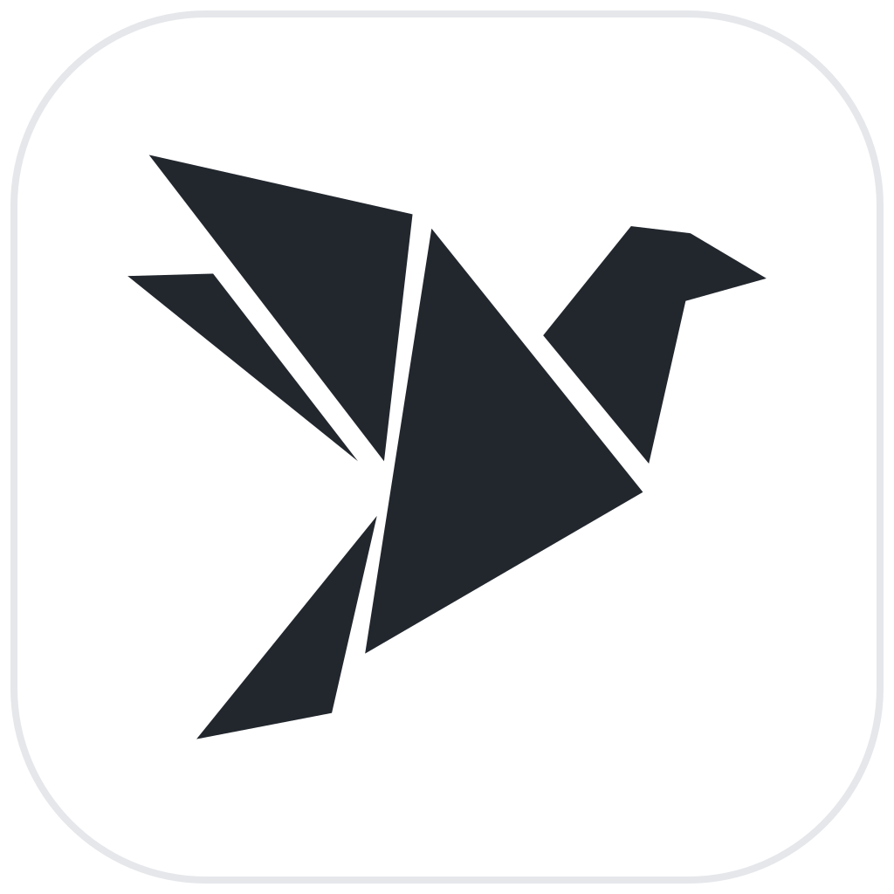
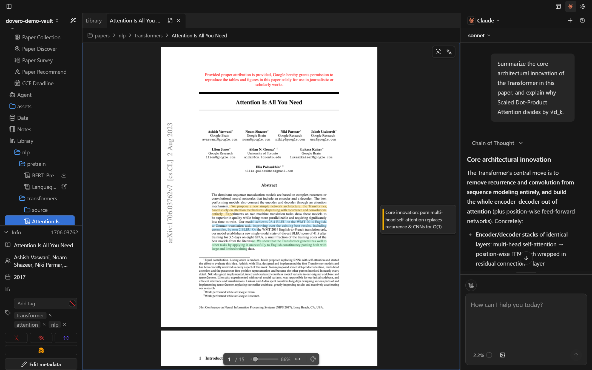
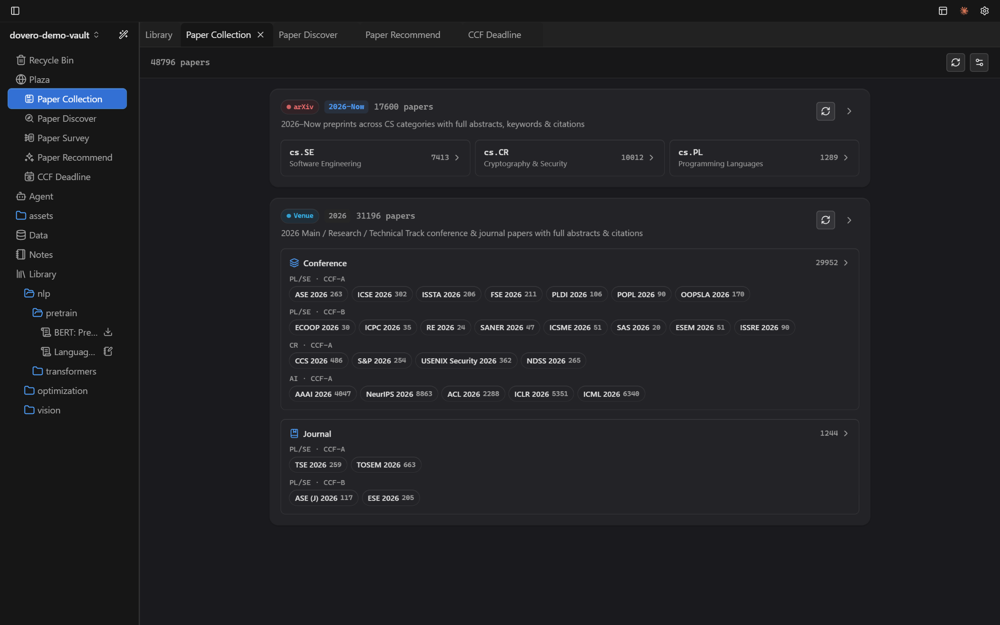
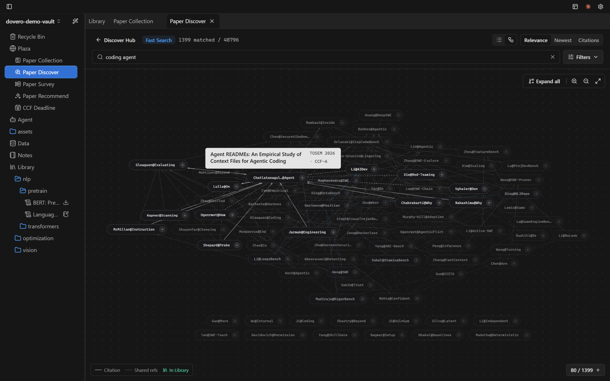
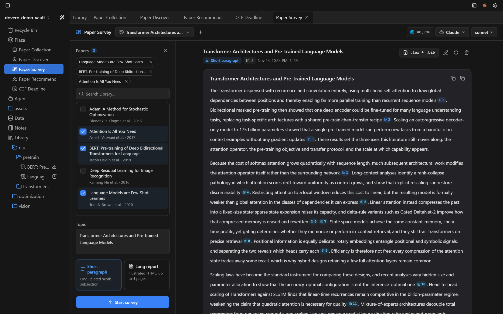
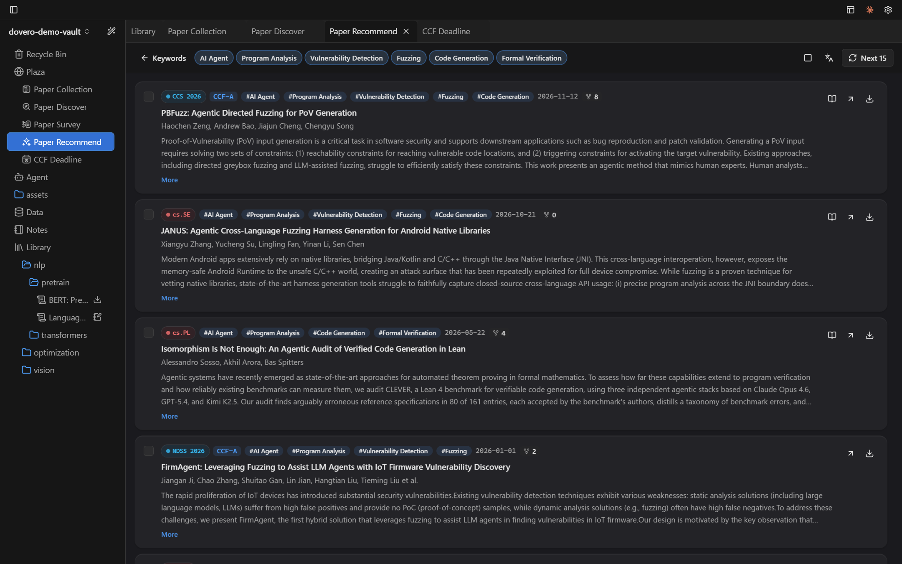
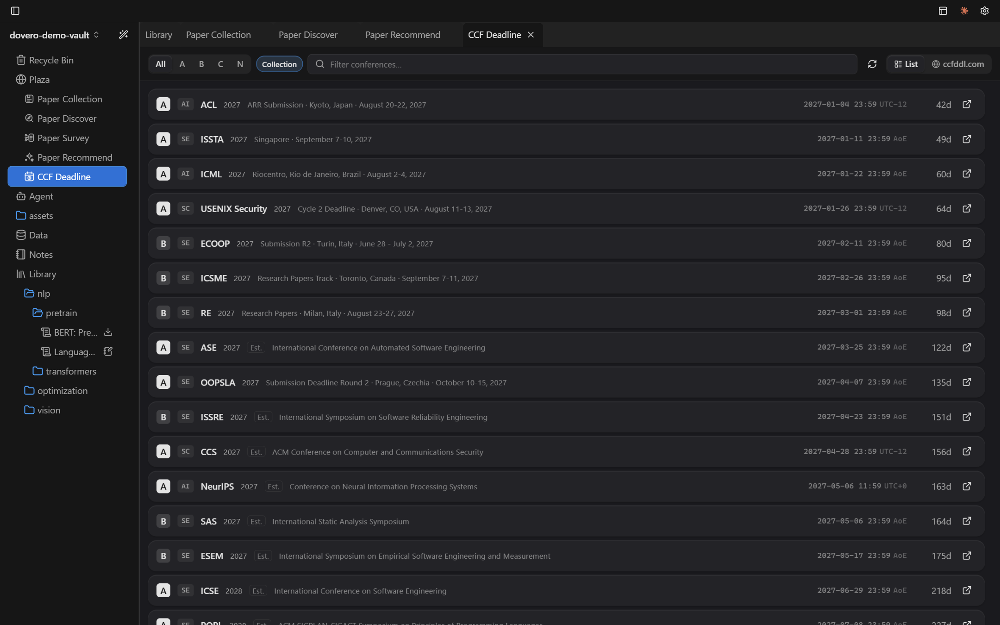

<p align="center">
  
</p>

<h1 align="center">Dovero</h1>

<h3 align="center">A Focused, Local-First Desktop Research Workbench for Paper Discovery, Reading & Agent Collaboration</h3>

<p align="center">
  Bringing the latest papers to your desk like an origami messenger dove — a streamlined, locally redesigned community fork of <a href="https://github.com/poco-ai/Agentero"><b>poco-ai/Agentero</b></a>: preserving comfortable PDF reading and bi-directional Markdown notes while expanding local paper-pool discovery, citation lineage, survey generation, and CARSI institutional access — lean, zero-account, and 100% local-first.
</p>

<p align="center">
  <a href="README.md">中文</a> | <b>English</b>
</p>

<p align="center">
  <a href="https://github.com/nonsense-j/Dovero/releases"></a>
  <a href="https://github.com/nonsense-j/Dovero/blob/main/LICENSE"></a>
  <a href="https://github.com/poco-ai/Agentero"></a>
</p>

> **Fork Notice & Acknowledgements**: **Dovero** is an independent community fork of **[poco-ai/Agentero](https://github.com/poco-ai/Agentero)** (not an official upstream release). The local-first library foundation, PDF viewer and layout pipeline, bi-directional Markdown editor, and local Agent protocol all originate from the upstream Agentero team. Dovero streamlines the scope around paper discovery and reading while selectively adopting upstream fixes — our sincere thanks to the original authors and contributors!

---

## Screenshots

<table>
  <tr>
    <td align="center" width="50%">
      <br />
      <sub><b>Annotated PDF Reading &amp; Local Agent</b> · Multi-color highlights, margin comments &amp; context-aware Q&amp;A</sub>
    </td>
    <td align="center" width="50%">
      <br />
      <sub><b>Paper Collection</b> · 28 top-venue main tracks &amp; arXiv preprints indexed locally</sub>
    </td>
  </tr>
  <tr>
    <td align="center" width="50%">
      <br />
      <sub><b>Paper Discover · Citation Lineage</b> · Instant local search with interactive citation &amp; shared-ref graphs</sub>
    </td>
    <td align="center" width="50%">
      <br />
      <sub><b>Paper Survey</b> · Cited Related Work generation from your library &amp; paper pool with LaTeX export</sub>
    </td>
  </tr>
  <tr>
    <td align="center" width="50%">
      <br />
      <sub><b>Paper Recommend</b> · Keyword-driven recommendations matched across the local paper pool</sub>
    </td>
    <td align="center" width="50%">
      <br />
      <sub><b>CCF Deadlines</b> · Filterable CCF-ranked conference submission countdowns</sub>
    </td>
  </tr>
</table>

---

## Key Differences from Upstream Agentero

| Area | Upstream [poco-ai/Agentero](https://github.com/poco-ai/Agentero) | **Dovero** |
|---|---|---|
| **Product Focus** | All-in-one research platform (reading, LaTeX writing/compiling, mobile apps, hosted cloud services, plugins) | Lean **desktop-only workbench** focused on paper discovery, reading, literature survey, and local Agent collaboration — zero accounts, zero telemetry |
| **Paper Plaza** | External paper feeds and recommendation browsing | Redesigned around five core panels: **Local Top-Venue & arXiv Paper Pool**, **Paper Discover** (fast search, citation lineage graph, Deep Search), **Paper Survey** (cited Related Work & HTML reports), **Recommendations**, and **CCF Deadlines** |
| **Institutional Access** | Generic institutional proxy gateway | Built-in university **CARSI SSO** login for publisher access detection and authenticated PDF ingestion |
| **Reading & Translation** | Broad multi-platform UX evolution and hosted translation flows | Prunes non-core subsystems, retains free zero-key and custom LLM translation options, and focuses on a calm, consistent split-view PDF reading, visual-region annotation, and bi-directional note-taking experience |

---

## Core Features

### 1. Paper Plaza: Discovery, Citation Lineage & Surveys
- **Paper Collection**: Aggregates 28 top-venue main tracks and arXiv papers locally with one-click seed sync, incremental background refreshes, and automatic keyword enrichment.
- **Paper Discover**: Instant local search, interactive **Citation Lineage Graph**, and multi-turn **Deep Search** research reports.
- **Paper Survey**: Combines your local library and paper pool to draft cited Related Work sections and exportable HTML survey reports.
- **Paper Recommend & CCF Deadline**: Personalized recommendations based on your local library plus an up-to-date CCF conference deadline tracker.

### 2. Structured PDF Reading, Translation & Bi-Directional Notes
- **PDF Reading & Annotation**: Crisp scaling, outline navigation, full-text search, multi-color highlights, margin comments, and **visual region framing** for figures, tables, algorithms, and equations.
- **Layout Analysis & Citation Previews**: Connects to remote or self-hosted layout parsers to index figures, tables, and formulas; click in-text citations to preview matching local papers inline.
- **Multi-Mode Translation**: Selection, side-by-side page, and full-document translation across free zero-key engines, standard translation APIs, OpenAI-compatible models, and Agent translation.
- **Bi-Directional Markdown Notes**: Split-view WYSIWYG notes linked with your PDF, supporting `[[wikilinks]]`, Callouts, interactive Mermaid diagrams, highlights/underlines, math rendering, and one-click LaTeX copy.

### 3. Local Agent Collaboration & Open Ecosystem
- **BYOA Local Agents**: Connects directly to locally installed agents such as Claude Code, Codex, OpenCode, and Antigravity CLI with selection quotes, in-page Quick Chat, and permission prompts — keeping your research context local.
- **Built-in MCP Server & CLI**: Optional local MCP server and headless CLI for integrating your library and notes with external AI tools and scripts.

### 4. Flexible Ingestion, Zotero Compatibility & Self-Hosted Sync
- **Effortless Import & CARSI**: Import via DOI / arXiv / title lookup, drag-and-drop PDFs, university CARSI SSO downloads, or the Zotero Connector browser extension.
- **Zotero Migration & BibTeX**: Migrate existing local Zotero libraries and export BibTeX / BibLaTeX.
- **Open Files & Multi-Device Sync**: Papers, notes, and annotations stay as open local files compatible with upstream vaults; sync across devices with your own **S3, WebDAV, or Git** backend.

---

## Quick Start

### 1. Download Desktop Installers (Windows / macOS)

Download prebuilt installers from **[GitHub Releases](https://github.com/nonsense-j/Dovero/releases)**:
- **Windows (x64)**: `*-setup.exe`
- **macOS (Apple Silicon)**: `*_aarch64.dmg`
- **macOS (Intel)**: `*_x64.dmg`

> **Upgrading from earlier fork builds**: On first launch, Dovero automatically migrates existing settings and your local paper pool into its own app directory without modifying your vaults, allowing side-by-side use with upstream Agentero.

### 2. Run & Build from Source

Prerequisites: Node.js 24+, pnpm, and the Rust stable toolchain (MSVC Build Tools on Windows).

```bash
# Install frontend dependencies
pnpm install

# Launch desktop app in dev mode
pnpm tauri dev

# Build desktop installer bundle
pnpm tauri build
```

For architecture and developer documentation, see [docs/architecture.md](docs/architecture.md), [docs/frontend/](docs/frontend/index.md), and [docs/backend/](docs/backend/index.md).

---

## Acknowledgements & License

- **Upstream [poco-ai/Agentero](https://github.com/poco-ai/Agentero)**: Deepest thanks to the original Agentero team and community contributors for designing and open-sourcing the local-first research workbench foundation. Dovero builds on their work while honoring upstream licensing and attribution.
- Thanks to Tauri, React, EmbedPDF, Plate, Dockview, OpenAlex, Semantic Scholar, and CCF Deadlines.
- Licensed under the [MIT License](LICENSE). Third-party notices are listed in [.github/THIRD_PARTY_NOTICES.md](.github/THIRD_PARTY_NOTICES.md).
