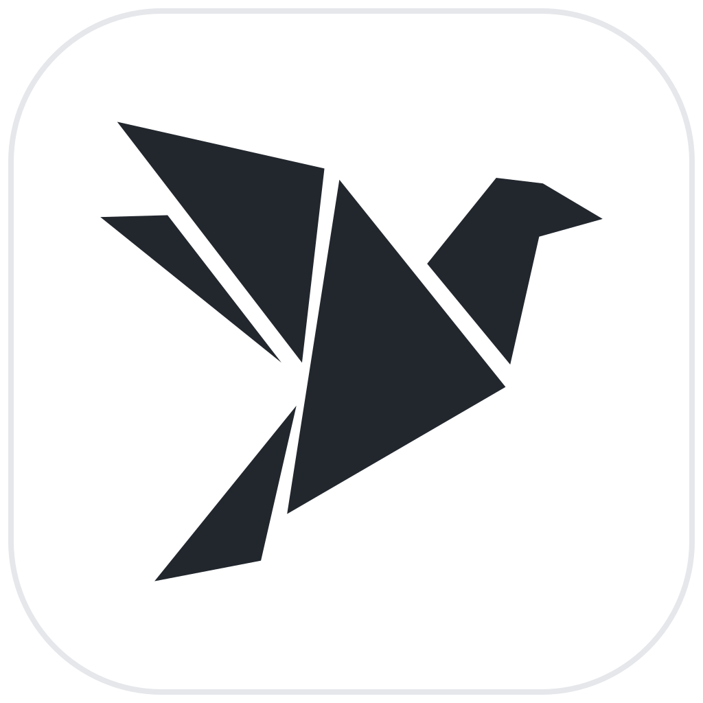
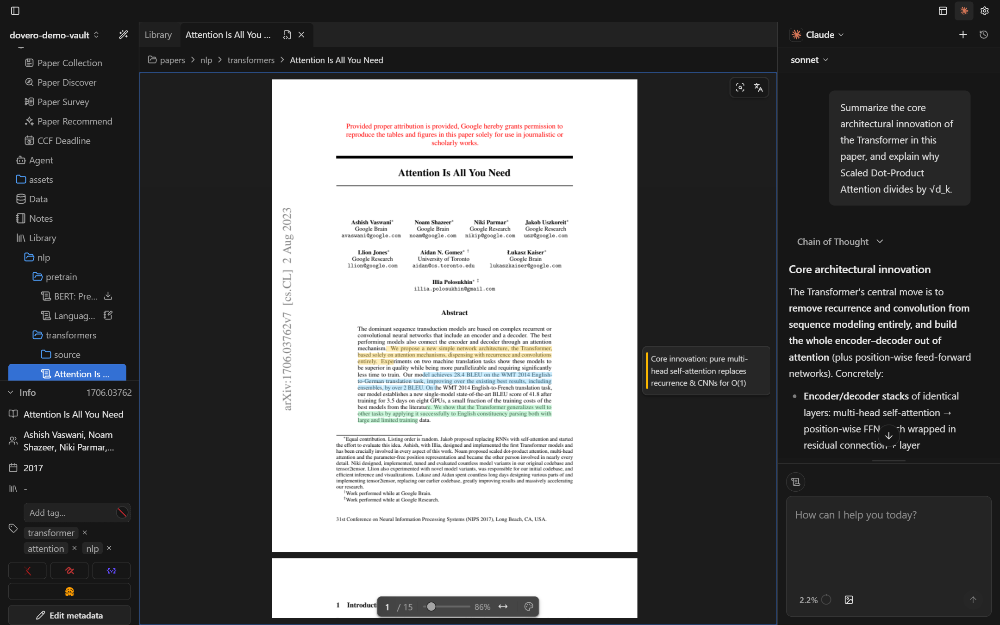
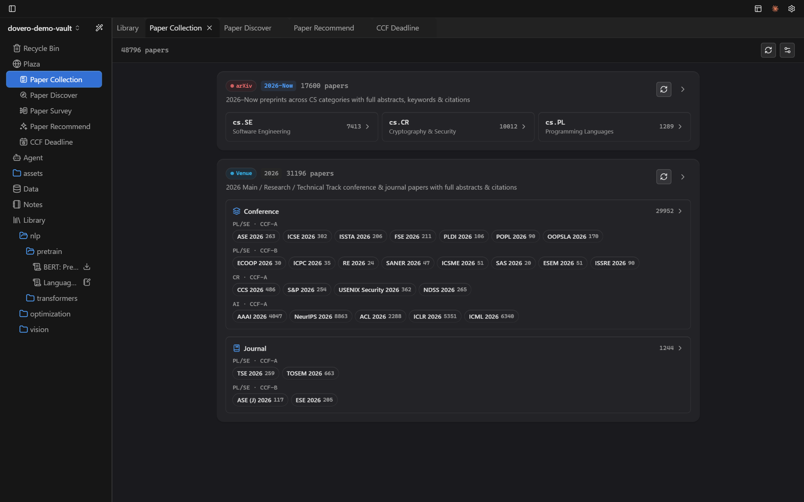
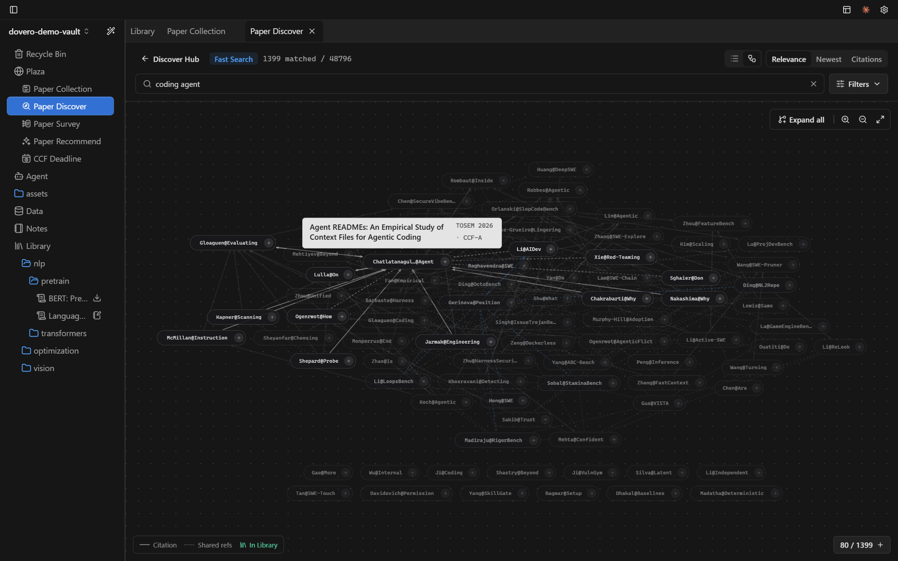
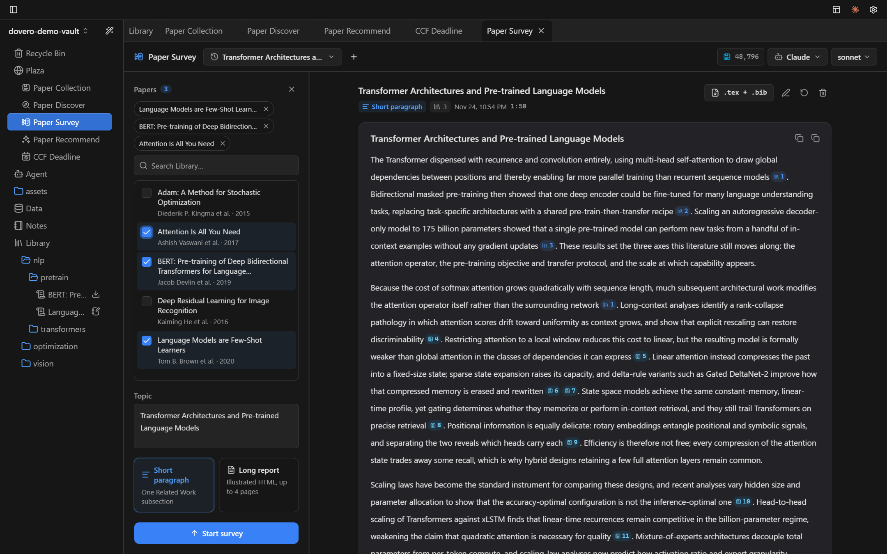
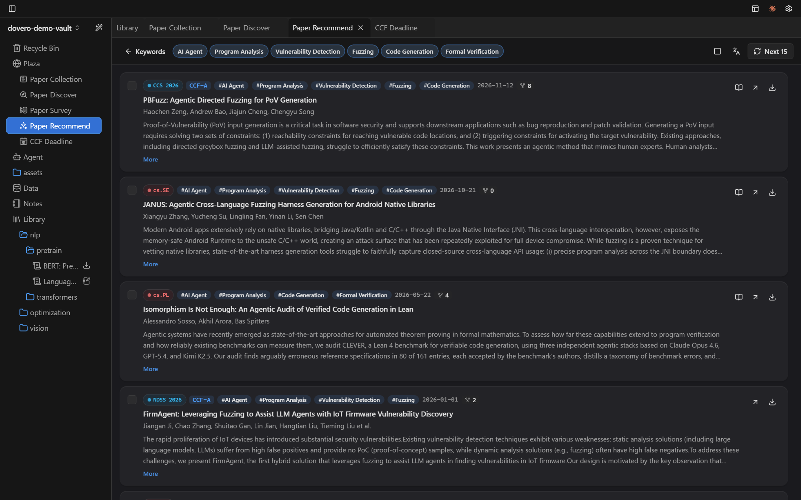
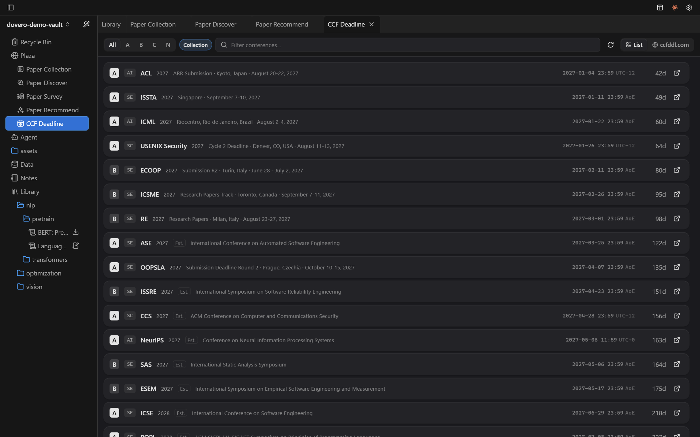

<p align="center">
  
</p>

<h1 align="center">Dovero</h1>

<h3 align="center">聚焦论文发现、结构化阅读与 Agent 协作的本地优先科研桌面工作台</h3>

<p align="center">
  像折纸信鸽把最新研究送到案头——基于开源项目 <a href="https://github.com/poco-ai/Agentero"><b>poco-ai/Agentero</b></a> 精简与重构的社区分叉版本：保留舒适的 PDF 阅读与双链笔记体验，强化本地论文池发现、引文谱系、综述生成与高校 CARSI 访问，轻量纯粹、零账号、完全本地存储。
</p>

<p align="center">
  <b>中文</b> | <a href="README.en.md">English</a>
</p>

<p align="center">
  <a href="https://github.com/nonsense-j/Dovero/releases"></a>
  <a href="https://github.com/nonsense-j/Dovero/blob/main/LICENSE"></a>
  <a href="https://github.com/poco-ai/Agentero"></a>
</p>

> **Fork 说明与致谢**：**Dovero** 是基于开源项目 **[poco-ai/Agentero](https://github.com/poco-ai/Agentero)** 分叉衍生的独立定制版本（非官方发行版）。本地优先文献库底座、PDF 阅读与版面分析框架、双链 Markdown 编辑器与本地 Agent 协议均源自原版 Agentero 团队的出色设计。我们在其基础上做了功能聚焦与论文发现工作流重构，并持续选择性吸收上游的修复与改进，衷心感谢原作者与所有上游贡献者！

---

## 界面预览

<table>
  <tr>
    <td align="center" width="50%">
      <br />
      <sub><b>PDF 标注阅读与本地 Agent 协作</b> · 多色高亮、页边批注与论文上下文问答</sub>
    </td>
    <td align="center" width="50%">
      <br />
      <sub><b>Paper Collection</b> · 本地聚合 28 个顶会/顶刊主轨与 arXiv 论文池</sub>
    </td>
  </tr>
  <tr>
    <td align="center" width="50%">
      <br />
      <sub><b>Paper Discover · 引文谱系图</b> · 毫秒级本地检索、引用与共引关系可视化</sub>
    </td>
    <td align="center" width="50%">
      <br />
      <sub><b>Paper Survey</b> · 结合文献库与论文池生成带可溯源引用的 Related Work 与 LaTeX 导出</sub>
    </td>
  </tr>
  <tr>
    <td align="center" width="50%">
      <br />
      <sub><b>Paper Recommend</b> · 基于研究关键词与本地论文池的个性化论文推荐</sub>
    </td>
    <td align="center" width="50%">
      <br />
      <sub><b>CCF Deadline</b> · 按分级与时间整理的顶会截稿倒计时</sub>
    </td>
  </tr>
</table>

---

## 与原版 Agentero 的核心区别

| 维度 | 原版 [poco-ai/Agentero](https://github.com/poco-ai/Agentero) | **Dovero** |
|---|---|---|
| **产品定位** | 全功能科研平台（覆盖阅读、LaTeX 写作编译、移动端、云服务与插件生态） | 聚焦**桌面端论文发现、文献阅读、综述整理与本地 Agent 协作**，更轻量、零账号、零遥测 |
| **论文广场（Plaza）** | 侧重外部论文资讯流与推荐浏览 | 重构为五大核心面板：**本地顶会与 arXiv 论文池**、**论文发现（快速检索 + 引文谱系图 + Deep Search）**、**综述与 Related Work 生成**、**个性化推荐**与 **CCF 截稿日历** |
| **高校机构访问** | 通用机构代理网关 | 针对国内高校内置 **CARSI 机构单点登录**，支持主流出版商权限识别与 PDF 入库 |
| **阅读与翻译体验** | 面向全平台持续演进多套新交互与托管翻译能力 | 精简非主线重型模块，保留免 Key 免费翻译与自定义大模型翻译，专注稳定、克制的 PDF 分屏阅读、区域框选批注与双链笔记体验 |

---

## 核心功能

### 1. 论文广场：发现、引文谱系与综述生成
- **Paper Collection（论文池）**：聚合 28 个顶会主轨与 arXiv 论文，支持一键种子同步、后台增量更新与关键词自动补全。
- **Paper Discover（深度发现）**：提供毫秒级本地检索、**引文谱系图**可视化，以及面向研究问题的多轮 **Deep Search** 调研报告。
- **Paper Survey（综述生成）**：结合本地文献库与论文池，辅助生成带准确引用的 Related Work 与可导出 HTML 综述报告。
- **Paper Recommend & CCF Deadline**：基于本地文献库的个性化论文推荐，以及按截稿日期整理的 CCF 会议列表。

### 2. PDF 结构化阅读、翻译与双链笔记
- **PDF 阅读与批注**：高清缩放、大纲导航、全文查找、多色高亮、页边评论，以及针对图/表/算法/公式的**视觉区域框选批注**。
- **版面解析与引用预览**：支持接入远程或自托管版面分析服务，自动识别图表与公式；点击文中引用可直接预览本地对应文献。
- **多模式翻译**：支持划词翻译、单页对照与全文翻译，内置免 Key 免费引擎并兼容常见翻译 API、OpenAI 兼容模型与 Agent 翻译。
- **双链 Markdown 笔记**：支持与 PDF 左右分屏联动，提供 `[[双链]]`、Callout、交互式 Mermaid 图表、高亮/下划线与公式渲染及一键复制 LaTeX。

### 3. 本地 Agent 协作与开放生态
- **BYOA 本地 Agent**：直接接入本机已安装的 Claude Code、Codex、OpenCode、Antigravity CLI 等本地 Agent，支持选区引用提问、页内 Quick Chat 与权限确认，所有文献上下文留在本地。
- **内置 MCP 服务与 CLI**：可选开启本地 MCP 服务或使用无头命令行工具，让外部 AI 客户端与脚本直接检索文献库与笔记。

### 4. 多途径入库、Zotero 兼容与自主同步
- **便捷入库与高校访问**：支持 DOI / arXiv / 标题检索入库、PDF 拖拽入库、高校 CARSI 单点登录辅助下载，以及 Zotero Connector 浏览器插件一键抓取。
- **Zotero 迁移与 BibTeX**：支持一键导入本地 Zotero 文献库，以及导出标准 BibTeX / BibLaTeX。
- **开放文件与多端同步**：PDF、笔记与批注均以开放本地文件存放，并与原版文献库格式保持互通；支持通过 **S3 / WebDAV / Git** 自主多端同步。

---

## 快速开始

### 1. 下载桌面安装包（Windows / macOS）

前往 **[GitHub Releases](https://github.com/nonsense-j/Dovero/releases)** 下载对应平台的预编译安装包：
- **Windows (x64)**：`*-setup.exe`
- **macOS (Apple Silicon)**：`*_aarch64.dmg`
- **macOS (Intel)**：`*_x64.dmg`

> **从旧分叉版本升级**：Dovero 首次启动时会自动把旧版本的配置与本地论文池无损迁移到独立目录，原有文献库可直接打开，也可与原版 Agentero 共存使用。

### 2. 从源码运行与构建

环境要求：Node.js 24+、pnpm、Rust Stable 工具链（Windows 需 MSVC Build Tools）。

```bash
# 安装前端依赖
pnpm install

# 启动桌面端开发模式
pnpm tauri dev

# 构建桌面安装包
pnpm tauri build
```

更多架构与开发文档请参阅 [docs/architecture.md](docs/architecture.md)、[docs/frontend/](docs/frontend/index.md) 与 [docs/backend/](docs/backend/index.md)。

---

## 致谢与许可证

- **核心致谢 [poco-ai/Agentero](https://github.com/poco-ai/Agentero)**：感谢原版 Agentero 团队与社区贡献者打造了这套优秀的本地优先科研工作台底座。Dovero 在尊重并保留上游开源协议与贡献记录的前提下持续演进。
- 感谢 Tauri、React、EmbedPDF、Plate、Dockview、OpenAlex、Semantic Scholar、CCF Deadlines 等开源项目与开放学术数据源。
- 本项目沿用原仓库的 [MIT License](LICENSE) 协议开源，第三方组件清单见 [.github/THIRD_PARTY_NOTICES.md](.github/THIRD_PARTY_NOTICES.md)。
